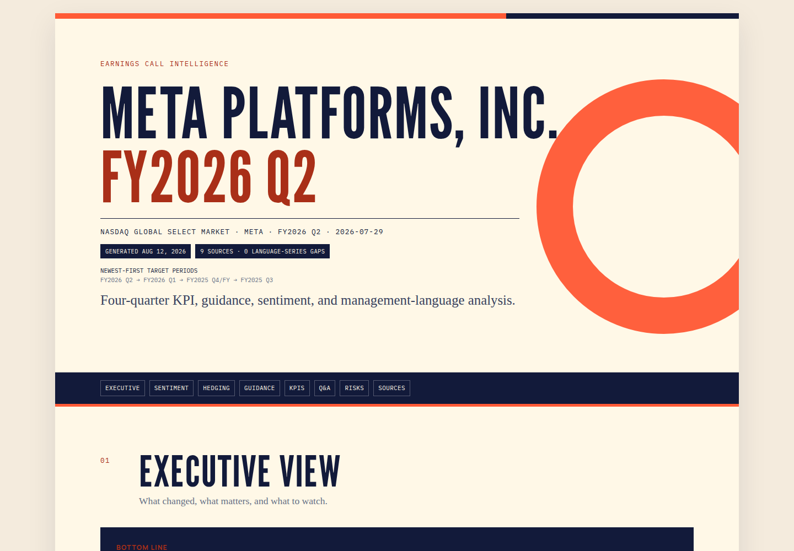
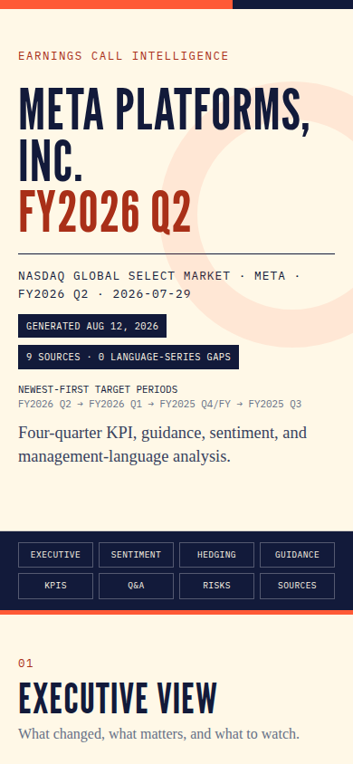

# Earnings Call Analyzer for Codex + Claude Code

Analyze a public company's four most recent earnings calls and generate a polished, self-contained HTML report.

The skill extracts key performance indicators and management guidance, compares executive sentiment across four calls, measures hedge-language frequency, and produces a responsive Dave Wang branded report with compact citations and precise source locators.



## Quick start

Replace `HOOD` with any public company ticker.

### Codex

Paste this into Codex:

```text
$skill-installer Install the skill from https://github.com/davidwang95/analyze-earnings-calls/tree/main/skills/analyze-earnings-calls
```

Then run:

```text
$analyze-earnings-calls HOOD
```

### Claude Code

Paste these into Claude Code:

```text
/plugin marketplace add davidwang95/analyze-earnings-calls
/plugin install earnings@davewang
```

Then run:

```text
/earnings:analyze-earnings-calls HOOD
```

If Claude Code asks you to reload after installation, run `/reload-plugins` once.

## Keep research out of this public repository

Store all real transcripts, normalized data, calculations, payloads, and reports in
[`local-research/`](local-research/README.md), whose contents are ignored except for
its guide. Enable the staging safeguard once per clone:

```bash
git config --local core.hooksPath .githooks
```

Requires Git and Python 3. If you already use hooks, integrate the checker with
your existing hook instead. Read [setup, workflow examples, and limits](docs/research-data-safety.md).
Hooks are opt-in and do not remove files already in Git history. Keep fixtures and
public examples free of real research.

## What the report contains

- Executive summary and current-versus-prior-quarter readout
- Four-call sentiment and hedge-language timeline
- Raw hedge counts and normalized rates per 1,000 executive words
- Key performance indicator history
- Guidance changes and comparability checks
- Management Q&A themes, risks, and watch items
- Compact inline citations with a detailed source-locator ledger
- Responsive desktop, mobile, and print layouts
- DaveWang.ai calls to action

## Example output

- [Open the self-contained example report](examples/example-earnings-call-report.html)
- The screenshot below shows the mobile cover layout.



## Repository structure

```text
skills/analyze-earnings-calls/
├── SKILL.md
├── agents/
├── assets/
├── evals/
├── good-vs-bad/
├── instructions/
├── references/
└── scripts/
```

The skill includes deterministic language-analysis scripts, schemas, branded report assets, good and bad examples, and an offline evaluation suite.

## Validate a change

Run from `skills/analyze-earnings-calls`:

```bash
python3 scripts/analyze_language.py --self-test
python3 scripts/render_report.py --self-test
python3 evals/run_evals.py
node scripts/qa_report_layout.mjs path/to/report.html
```

The browser layout check requires Chromium or Google Chrome.

## About

Created by [Dave Wang](https://www.davewang.ai) for investors who want a repeatable way to analyze management language, KPIs, and guidance across earnings calls.
